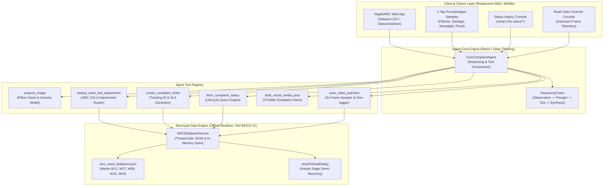

# Technical Architecture & Systems Specification
## NagrikAMC · Autonomous Civic Complaint Agent (Track 01)

### 1. High-Level Architecture Diagram



---

### 2. Registered Agent Tools Specification

| Tool Name | Input Payload | Output Payload | Description |
|---|---|---|---|
| `analyze_image` | `image_bytes: bytes`, `filename: str` | `ImageAnalysisResult` (issue, confidence, severity, features, boundingBox) | Computer vision surface classifier for potholes, garbage, streetlights, and waterlogging. |
| `lookup_ward_and_department` | `area: str`, `issue: IssueType`, `coords: Optional[Dict]` | `WardLookupResult` (wardId, wardName, zone, officer, department, slaHours, leadEngineer) | Maps Ahmedabad localities (CG Road, Stadium, Kankaria, Vastrapur) to AMC wards and departments. |
| `create_complaint_ticket` | `ward_id: str`, `area: str`, `issue: IssueType`, `description: str`, `priority: str` | `Complaint` (trackingId, status, filedAt, expectedSlaAt, assignedTo, timeline) | Commits ticket to municipal database and assigns tracking ID (`AMC-2026-XXXXXX`). |
| `fetch_complaint_status` | `trackingId: str` | `Complaint` | Fetches live municipal record, status stage, and chronological audit history. |
| `draft_social_media_post` | `complaint: Complaint` | `SocialMediaDraft` (text, tags, mentions, intentUrl) | Drafts public accountability post tagging `@AhmedabadAMC` with 1-click Twitter intent. |
| `scan_video_potholes` | `intervalSeconds: int = 3` | `VideoScanReport` (frames, hazardsDetected, filedTickets) | Road inspection engine: samples frames every 3s along CG Road, detects craters, and auto-files tickets. |

---

### 3. AMC Municipal Schema

```json
{
  "wards": [
    {
      "id": "W12",
      "name": "Navrangpura",
      "zone": "West",
      "areas": ["Navrangpura", "Stadium", "CG Road", "Law Garden", "Gujarat University"],
      "officeAddress": "AMC West Zone Office, Usmanpura, Ahmedabad - 380013",
      "wardOfficer": "Shri Arvind Trivedi",
      "contactPhone": "+91-79-2755-1201"
    },
    {
      "id": "W27",
      "name": "Maninagar",
      "zone": "South",
      "areas": ["Maninagar", "Kankaria", "Jawahar Chowk", "Rambaug"],
      "officeAddress": "AMC South Zone Office, Rambaug, Maninagar, Ahmedabad - 380008",
      "wardOfficer": "Smt. Bhavna Solanki",
      "contactPhone": "+91-79-2546-4301"
    }
  ],
  "departments": {
    "pothole": "Roads & Buildings",
    "garbage": "Solid Waste Management",
    "streetlight": "Light Department",
    "waterlogging": "Storm Water Drainage"
  },
  "complaints": [
    {
      "trackingId": "AMC-2026-000123",
      "ward": "W12",
      "issue": "pothole",
      "status": "Assigned",
      "filedAt": "2026-10-24T17:20:00+05:30"
    }
  ]
}
```

---

### 4. Lifecycle State Machine
```
[Submitted] ──> [Assigned] ──> [In Progress] ──> [Work Verified] ──> [Resolved]
```
- **Submitted**: Citizen image triaged and validated.
- **Assigned**: Routed to Ward cell & Lead Department Engineer with SLA timer.
- **In Progress**: Inspection crew and repair machinery dispatched to location.
- **Work Verified**: Photographic repair evidence audited by municipal supervisor.
- **Resolved**: Quality audit cleared, ticket closed, citizen notified.
