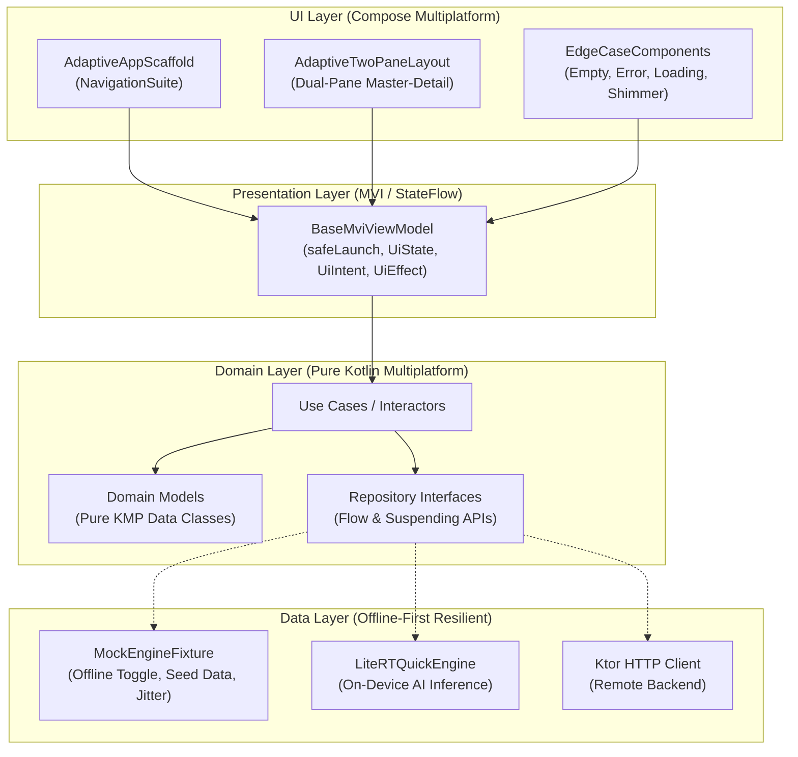

# Hack2Skill Hackathon 4-Hour Victory System 🚀
> **Kotlin Multiplatform (Android, iOS, Desktop, Web Wasm) | Multi-Device Adaptive Architecture | Autonomous Agent Pair-Programming System**

Welcome to the **Hack2Skill Hackathon 4-Hour Victory System**. This repository is an end-to-end, high-velocity engineering kit designed for **Dhruv Patel** (Android Artist & Lead Engineer) pair-programming with AI assistants (**Antigravity**, **Claude Code**, or **Cursor**) during intense hackathons (like Hack2Skill) where coding time is strictly constrained to **4 hours** and on-site volunteer duties require maximum autonomy, zero placeholders, and flawless offline resilience.

---

## 📑 Table of Contents

- [Architectural Overview](#-architectural-overview)
- [Project Directory Structure & Code Links](#-project-directory-structure--code-links)
- [Technical Stack & Blueprints](#-technical-stack--blueprints)
- [Autonomous Agents & Slash Commands](#-autonomous-agents--slash-commands)
- [Installed Skills Integration (`INV-SKILL-01`)](#-installed-skills-integration-inv-skill-01)
- [Edge-Case Defense Matrix (`INV-EDGE-01`)](#-edge-case-defense-matrix-inv-edge-01)
- [Continuous Documentation Sync Protocol (`INV-DOCS-SYNC-01`)](#-continuous-documentation-sync-protocol-inv-docs-sync-01)
- [Developer Quick Start & Commands](#-developer-quick-start--commands)
- [4-Hour Hackathon Time Matrix](#-4-hour-hackathon-time-matrix)
- [Hack2Skill Submission & Pitch Artifacts](#-hack2skill-submission--pitch-artifacts)

---

## 🏛️ Architectural Overview

The codebase is built on **Clean Architecture** and **Unidirectional Data Flow (MVI)** principles, ensuring total isolation between UI, domain logic, and data providers:



### Core Architecture Invariants:
1. **Pure Kotlin Domain (`INV-ARCH-01`)**: Zero Android (`android.*`) and zero Compose (`androidx.compose.*`) imports in `domain/`.
2. **MVI State Machine**: Every feature exposes an immutable `UiState`, a sealed `UiIntent`, and a single-shot `UiEffect` Channel.
3. **Zero Main-Thread Blocking (`INV-THREAD-01`)**: All I/O, heavy calculations, and AI inference execute on `Dispatchers.IO` or `Dispatchers.Default`.
4. **Mock-First Live Demo Defense (`INV-MOCK-01`)**: A reactive mock data engine with seed fixtures and instant offline toggle (`isOfflineMode`) guarantees the live stage presentation never fails if venue Wi-Fi drops.

---

## 📁 Project Directory Structure & Code Links

Click any link below to jump directly to the verified implementation or specification:

```
hck2skill-hackthon-24-oct-26/
├── README.md                                          # Master repository overview (this file)
├── .gitignore                                         # Git filtering for macOS, IDE, and Gradle
├── AGENTS.md                                          # Workspace assistant rules & invariants
├── CLAUDE.md                                          # Claude Code commands & cheat-sheet
├── .cursorrules                                       # Cursor IDE configuration & auto-prompts
└── hackathon-kit/
    ├── README.md                                      # 4-Hour Victory Blueprint playbook
    ├── AGENTS.md                                      # Sub-module agent instructions
    ├── CLAUDE.md                                      # Sub-module Claude rules
    ├── .cursorrules                                   # Sub-module Cursor rules
    │
    ├── blueprints/                                    # Ready-to-use production blueprints
    │   ├── compose/
    │   │   ├── AdaptiveAppScaffold.kt                 # Multi-device adaptive navigation shell
    │   │   ├── AdaptiveTwoPaneLayout.kt               # Responsive master-detail dual-pane layout
    │   │   ├── AdaptiveLayoutTokens.kt                # Breakpoints (Compact, Medium, Expanded)
    │   │   ├── SpacingTokens.kt                       # Capsule buttons, 48dp touch targets, tokens
    │   │   └── EdgeCaseComponents.kt                  # Empty/Error/Skeleton cards, form insets
    │   ├── presentation/
    │   │   └── BaseMviViewModel.kt                    # MVI base view model with safeLaunch
    │   ├── data/
    │   │   └── MockEngineFixture.kt                   # Deterministic offline mock engine & toggle
    │   ├── ai/
    │   │   └── LiteRTQuickEngine.kt                   # On-device AI engine with timeout protection
    │   ├── gradle/
    │   │   ├── libs.versions.toml                     # KMP/CMP Gradle version catalog
    │   │   ├── build.gradle.kts                       # Root multiplatform Gradle build config
    │   │   └── settings.gradle.kts                    # Gradle multi-module project settings
    │   └── shared/
    │       └── build.gradle.kts                       # Shared multiplatform module build script
    │
    ├── .agents/                                       # Multi-agent system configuration
    │   ├── AGENTS.md                                  # Canonical index of agent roles & rules
    │   ├── skills.json                                # Configured skill discovery roots
    │   ├── commands/
    │   │   ├── boost.md                               # /boost: Prompt Auto-Expansion Engine
    │   │   ├── plan.md                                # /plan: 4-Hour Rapid Execution Planner
    │   │   └── learn.md                               # /learn: Continuous Learning & Instincts
    │   ├── rules/
    │   │   ├── hackathon-4hr-protocol.md              # 4-hour sprint & anti-rabbit-hole rule
    │   │   ├── clean-architecture-kmp.md              # Pure Kotlin domain & MVI contracts
    │   │   ├── adaptive-ui-multiplatform.md           # Multi-device breakpoints & layout tokens
    │   │   ├── mock-first-resilience.md               # Zero-flake mock data engine invariant
    │   │   ├── hack2skill-judging-rubric.md           # Hack2Skill scoring optimization
    │   │   ├── ai-edge-intelligence.md                # On-device LiteRT & Gemini Prompt API
    │   │   ├── prompt-expansion-protocol.md           # 7-dimensional prompt auto-expansion
    │   │   ├── edge-case-defense-matrix.md            # Mandatory empty/error/loading safeguards
    │   │   ├── hackathon-planning-protocol.md         # Time-boxed sprint planning formula
    │   │   ├── continuous-learning-protocol.md        # Permanent memory & instinct recording
    │   │   ├── installed-skills-usage.md              # Mandatory installed skills execution (INV-SKILL-01)
    │   │   └── docs-sync-protocol.md                  # Continuous documentation sync (INV-DOCS-SYNC-01)
    │   └── agents/
    │       ├── architect-scaffolder.md                # Persona: Lead Architect & Scaffolder
    │       ├── cmp-ui-designer.md                     # Persona: Compose Multiplatform UI Specialist
    │       ├── engine-data-integrator.md              # Persona: Data Engine & Edge AI Integrator
    │       ├── quality-verifier.md                    # Persona: QA & Verification Gate Auditor
    │       └── pitch-submission-lead.md               # Persona: Pitch & Submission Lead
    │
    ├── Docs/                                          # Submission artifacts & documentation
    │   ├── problem_assessment_worksheet.md            # 10-minute problem deconstruction canvas
    │   ├── architecture_template.md                   # Architecture spec with Mermaid diagrams
    │   ├── pitch_deck_template.md                     # 7-slide winning Hack2Skill pitch deck
    │   ├── demo_video_script.md                       # 2-minute video walkthrough script
    │   ├── hack2skill_submission_template.md          # Complete submission form copy
    │   └── learnings/
    │       └── hackathon_learnings.md                 # Project memory & defensive instincts
    │
    └── scripts/                                       # Automation & verification scripts
        ├── check-hackathon-readiness.sh               # 37-point pre-sprint verification auditor
        └── bootstrap-new-hackathon-repo.sh            # One-command injector for fresh repositories
```

---

## 🛠️ Technical Stack & Blueprints

| Component | Technology | Version | Location / Blueprint Link |
|---|---|---|---|
| **Language** | Kotlin Multiplatform | `2.1.0` | [libs.versions.toml](hackathon-kit/blueprints/gradle/libs.versions.toml) |
| **UI Toolkit** | Compose Multiplatform | `1.7.1` | [AdaptiveAppScaffold.kt](hackathon-kit/blueprints/compose/AdaptiveAppScaffold.kt) |
| **Architecture** | Clean Architecture + MVI | Pure KMP | [BaseMviViewModel.kt](hackathon-kit/blueprints/presentation/BaseMviViewModel.kt) |
| **Adaptive Layout** | Material 3 Adaptive | `1.0.0` | [AdaptiveTwoPaneLayout.kt](hackathon-kit/blueprints/compose/AdaptiveTwoPaneLayout.kt) |
| **Design System** | Capsule Spacing Tokens | Custom | [SpacingTokens.kt](hackathon-kit/blueprints/compose/SpacingTokens.kt) |
| **Edge-Case UI** | Empty/Error/Shimmer/IME | Custom | [EdgeCaseComponents.kt](hackathon-kit/blueprints/compose/EdgeCaseComponents.kt) |
| **Data Engine** | Reactive In-Memory Mock | Coroutines | [MockEngineFixture.kt](hackathon-kit/blueprints/data/MockEngineFixture.kt) |
| **On-Device AI** | Google AI Edge LiteRT | `1.0.1` | [LiteRTQuickEngine.kt](hackathon-kit/blueprints/ai/LiteRTQuickEngine.kt) |
| **Networking** | Ktor HTTP Client | `3.0.2` | [build.gradle.kts](hackathon-kit/blueprints/shared/build.gradle.kts) |
| **Serialization** | Kotlinx Serialization JSON | `1.7.3` | [libs.versions.toml](hackathon-kit/blueprints/gradle/libs.versions.toml) |
| **Async & State** | Kotlinx Coroutines & Flows | `1.9.0` | [BaseMviViewModel.kt](hackathon-kit/blueprints/presentation/BaseMviViewModel.kt) |

---

## 🤖 Autonomous Agents & Slash Commands

During high-intensity hackathons, prompt engineering by hand is a bottleneck. The kit provides three self-enhancing slash commands backed by specialized agent personas:

### ⚡ Built-in Slash Commands

1. **`/boost [instruction]`** ([boost.md](hackathon-kit/.agents/commands/boost.md)):
   - **Trigger**: Automatic on ANY instruction, or explicitly invoked with `/boost`.
   - **What it does**: Automatically expands terse, plain-English instructions across 7 architectural dimensions: Persona -> Domain Entity -> Resilient Mock Data -> MVI ViewModel -> Adaptive Compose UI -> Edge-Case Cards -> Installed Skills Activation.
   - **Output**: Complete, compilable Kotlin files with zero placeholders (`// TODO`).

2. **`/plan [concept]`** ([plan.md](hackathon-kit/.agents/commands/plan.md)):
   - **When to use**: When the hackathon problem statement is announced.
   - **What it does**: Enforces the **1-Flow Rule** (1 killer end-to-end journey > 5 half-done screens) and generates an hour-by-hour roadmap across the 4-Hour Time Matrix.

3. **`/learn [lesson]`** ([learn.md](hackathon-kit/.agents/commands/learn.md)):
   - **When to use**: Whenever a subtle bug, Kotlin/Wasm anomaly, or layout edge-case is solved.
   - **What it does**: Records an atomic instinct (`Trigger -> Trap -> Defensive Pattern`) into [hackathon_learnings.md](hackathon-kit/Docs/learnings/hackathon_learnings.md) so the system never repeats the mistake.

### 👥 Agent Personas Roster

| Agent Persona | Role File | Primary Function in 4-Hour Sprint |
|---|---|---|
| **Lead Architect** | [architect-scaffolder.md](hackathon-kit/.agents/agents/architect-scaffolder.md) | Hour 1: Deconstructs problem, creates domain entities & repository interfaces. |
| **UI Specialist** | [cmp-ui-designer.md](hackathon-kit/.agents/agents/cmp-ui-designer.md) | Hour 2: Builds responsive Material 3 UI with adaptive navigation & capsule styling. |
| **Data & AI Integrator**| [engine-data-integrator.md](hackathon-kit/.agents/agents/engine-data-integrator.md) | Hour 1-3: Builds offline mock engine with live toggle, Ktor clients, and LiteRT AI hooks. |
| **Quality Auditor** | [quality-verifier.md](hackathon-kit/.agents/agents/quality-verifier.md) | Hour 3: Executes multiplatform tests, audits Edge-Case Matrix, and triggers `/learn`. |
| **Pitch & Submission** | [pitch-submission-lead.md](hackathon-kit/.agents/agents/pitch-submission-lead.md) | Hour 4: Crafts Hack2Skill pitch deck, README, and 2-minute demo video script. |

---

## 🧩 Installed Skills Integration (`INV-SKILL-01`)

The environment connects over **100 installed specialist skills** located in `~/.gemini/config/skills/`, `~/.agents/skills/`, and `~/.gemini/antigravity/builtin/skills/` (configured in [skills.json](hackathon-kit/.agents/skills.json)).

Assistants must always consult the corresponding skill's `SKILL.md` before generating code:

| Capability Domain | Active Installed Skill | Applied Best Practices |
|---|---|---|
| **Adaptive Layouts** | `adaptive` | Compose MediaQuery API, Foldable/Tablet two-pane scenes, responsive window size classes |
| **Modern Navigation** | `navigation-3`, `navigation-event` | Navigation 3 scenes, multi-backstack routing, predictive back `NavigationBackHandler` |
| **Insets & Edge-to-Edge** | `edge-to-edge` | Full edge-to-edge support, IME keyboard avoidance, transparent system bar legibility |
| **Design System & Styles**| `styles` | Jetpack Compose Styles API, styleable design system components, unified style attributes |
| **On-Device LLMs** | `litert-lm` | Open LLMs (Gemma, Qwen, Llama) with LiteRT-LM Kotlin API (`litertlm-android`) |
| **On-Device Vision / TFLite**| `litert-runtime` | LiteRT CompiledModel API on CPU/GPU, TensorBuffer reuse, Bitmap preprocessing |
| **Gemini Nano** | `ml-kit-genai-prompt-api` | On-device prompt API, prefix caching, structured output with Gemini Nano |
| **System AI Shortcuts** | `appfunctions` | Expose on-device workflows to Android system shortcuts and AI agents |
| **Testing Infrastructure** | `testing-setup`, `verify` | Unit/UI/E2E test harnesses, pre-submission diff-vs-base review gate |
| **Compose Performance** | `jetpack-compose-performance` | Recomposition tracking, frame drop elimination, LazyList optimizations |
| **ANR & Threading** | `anr-audit-and-fix` | Scan codebase for main-thread blocking, ANR risks, and coroutine stalls |
| **Headless Debugging** | `debroid`, `android-cli` | JDWP live debugging, Compose state inspection, virtual device manager |

Detailed rules: [installed-skills-usage.md](hackathon-kit/.agents/rules/installed-skills-usage.md).

---

## 🛡️ Edge-Case Defense Matrix (`INV-EDGE-01`)

Every screen and feature in this repository is fortified against common live-demo failure modes:

| Failure Mode | Risk to Demo | Out-of-the-Box Safeguard in [EdgeCaseComponents.kt](hackathon-kit/blueprints/compose/EdgeCaseComponents.kt) |
|---|---|---|
| **Empty Result Set** | Blank screen on 0 results | `EmptyStateCard` with custom icon, explanation, and action button |
| **Network Failure** | App crash or freeze | `ErrorStateCard` with explicit error badge and "Retry" callback |
| **Loading Latency** | User confusion during delay | `LoadingSkeletonCard` with animated shimmer gradient |
| **Text Overflow** | Long titles break cards | Dynamic labels use `maxLines = 1` or `2` and `TextOverflow.Ellipsis` |
| **Ultrawide Desktop** | Layout stretches across 4K displays | `AdaptiveContainer(maxContentWidth = 1200.dp)` clamps and centers content |
| **Soft Keyboard (IME)**| Mobile keyboard covers inputs | `AdaptiveFormLayout` with `Modifier.imePadding()` and `verticalScroll` |
| **Form Validation** | Blank or invalid inputs crash backend | `ValidatedInputField` with character limits, inline errors, and clear button |
| **Double-Click Spam**| Rapid double-tap creates duplicate items | `debouncedClickable(debounceMs = 500)` click protection with ripple preserved |
| **Key Collision** | Timestamp collisions crash LazyColumn | Monotonic counter appended to IDs: `mock_${now()}_${++idCounter}` |
| **Live Stage Outage** | Conference Wi-Fi drops during pitch | Reactive mock engine with toggle (`isOfflineMode`) and `DemoModeBanner` |
| **Rehearsal Clutter**| Pre-demo test entries pollute state | `resetToSeedData()` restores clean seed state with one tap |
| **Image Load Drop** | Missing avatar renders blank space | `SafeAsyncImagePlaceholder` fallback container |
| **Wasm Dispatchers** | Single-threaded browser loop crash | Use `Dispatchers.Default` for CPU work; avoid blocking threads |
| **AI Inference Hang**| On-device LiteRT model takes >4s | `withTimeoutOrNull(4000L)` and `runCatching` with heuristic fallback |
| **Coroutine Teardown**| Swallowing cancellation breaks scope | Ignored `CancellationException` in exception handlers |

---

## 🔄 Continuous Documentation Sync Protocol (`INV-DOCS-SYNC-01`)

**Rule**: Code and documentation must never drift apart. Whenever any task, feature implementation, refactoring, or blueprint addition is completed, the developer or AI assistant MUST automatically execute the synchronization cycle:

1. **Update Technical Specs**: Document newly added libraries, Gradle plugins, or API integrations in [README.md](README.md) and [hackathon-kit/README.md](hackathon-kit/README.md).
2. **Synchronize Directory Structure**: Update the ASCII directory tree in [README.md](README.md) to reflect newly created or reorganized files.
3. **Add Direct Code Links**: Add relative clickable links to all newly created Kotlin classes, ViewModels, Composables, or scripts.
4. **Update Learnings**: If a subtle bug, Wasm quirk, or layout anomaly was resolved, record the instinct in [hackathon_learnings.md](hackathon-kit/Docs/learnings/hackathon_learnings.md).

Detailed protocol: [docs-sync-protocol.md](hackathon-kit/.agents/rules/docs-sync-protocol.md).

---

## ⚡ Developer Quick Start & Commands

### Prerequisites
- JDK 17+ or JDK 21
- Android Studio Ladybug+ / IntelliJ IDEA 2024.2+ / VS Code / Cursor
- Git

### Build & Verification Commands

```bash
# 1. Run Hackathon 37-Point Readiness Audit
./hackathon-kit/scripts/check-hackathon-readiness.sh

# 2. Run Multiplatform Unit Tests
./gradlew test

# 3. Assemble Android Debug APK
./gradlew :composeApp:assembleDebug

# 4. Launch Desktop (JVM) App
./gradlew :composeApp:run

# 5. Launch Web (Kotlin/Wasm) App in Browser
./gradlew :composeApp:wasmJsBrowserDevelopmentRun
```

### Bootstrap a Fresh Hackathon Repo in 10 Seconds
To inject this complete architecture, agent system, blueprints, and submission templates into a new project:
```bash
./hackathon-kit/scripts/bootstrap-new-hackathon-repo.sh /path/to/my-fresh-hackathon-app --init-gradle
```

---

## ⏱️ 4-Hour Hackathon Time Matrix

```
┌─────────────────────────────────────────────────────────────────────────────┐
│ 00:00 - 00:30 │ Phase 0: Problem Scoping & Architecture Lock (Agent 1)      │
│ 00:30 - 01:15 │ Phase 1: Core Domain Models & Mock-First Data Engine        │
│ 01:15 - 02:45 │ Phase 2: Adaptive Compose UI (Mobile, Web, Desktop)         │
│ 02:45 - 03:30 │ Phase 3: Integration (Live API/AI Edge) & QA Invariants     │
│ 03:30 - 04:00 │ Phase 4: Pitch Deck, Demo Video Script & Hack2Skill Freeze   │
│ 04:00 ──► 🏆  │ SUBMISSION SUBMITTED & LIVE STAGE DEMO READY               │
└─────────────────────────────────────────────────────────────────────────────┘
```

---

## 🏆 Hack2Skill Submission & Pitch Artifacts

The repository includes pre-formatted, winning templates optimized for Hack2Skill judging rubrics:

- **[problem_assessment_worksheet.md](hackathon-kit/Docs/problem_assessment_worksheet.md)**: 10-minute problem deconstruction canvas to lock the 1-Flow MVP.
- **[pitch_deck_template.md](hackathon-kit/Docs/pitch_deck_template.md)**: 7-slide pitch deck structure covering Hook, Problem, Solution, Architecture, Live Demo, Market, and Team.
- **[demo_video_script.md](hackathon-kit/Docs/demo_video_script.md)**: 2-minute video walkthrough script ensuring you demo the problem, intelligent solution, and offline resilience within time limits.
- **[architecture_template.md](hackathon-kit/Docs/architecture_template.md)**: Ready-to-render Mermaid diagrams and component contracts for technical judges.
- **[hack2skill_submission_template.md](hackathon-kit/Docs/hack2skill_submission_template.md)**: Exact submission form copy ready to copy-paste into the Hack2Skill portal.
- **[hackathon_learnings.md](hackathon-kit/Docs/learnings/hackathon_learnings.md)**: Living instincts registry preventing repeat bugs during the sprint.

---

*Engineered with precision for Dhruv Patel. Ready to build, pitch, and win.*
