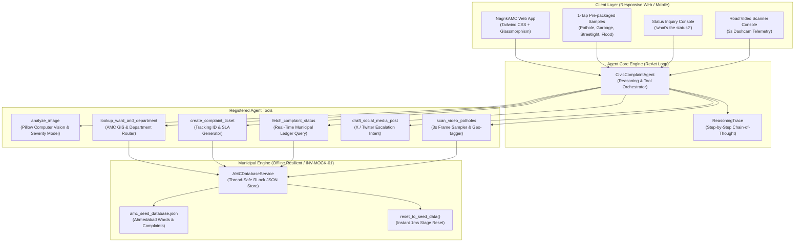

# NagrikAMC · Autonomous Civic Complaint Agent 🏛️🤖
> **Track 01 · Hack2Skill Hackathon 2026 | AI Reasons, Uses Tools, and Takes Action**  
> *Built for Ahmedabad Municipal Corporation (AMC) · 100% Offline Resilient (`INV-MOCK-01`)*

Welcome to **NagrikAMC** (also known as **CivicPulse AI**), an autonomous civic triage and complaint execution agent. In Indian municipal governance, reporting a road pothole, overflowing garbage dump, unlit streetlight, or monsoon waterlogging currently requires identifying the correct ward (out of 48) and the responsible municipal department (out of 14), filling cumbersome forms, and chasing tickets for weeks.

**NagrikAMC eliminates this administrative friction through an autonomous ReAct AI Agent:**
1. **Photo goes in**: Computer vision models classify the civic issue and surface failure severity.
2. **Autonomous Tool Pipeline**: The agent identifies the issue, resolves the exact AMC ward and department, generates an official complaint with a tracking ID (`AMC-2026-XXXXXX`), sets an SLA timer, and drafts a public social media escalation post.
3. **Conversational Status Inquiry**: The citizen asks *"what's the status?"* and gets real-time progress details with an interactive chronological audit trail.
4. **Road Video Scanner (Stretch Goal)**: Feeds continuous road footage, samples frames every 3 seconds, detects craters, logs GPS telemetry, and bulk-files complaints autonomously.

---

## 🎯 Hackathon Submission Overview: Vertical, Approach, Logic & Assumptions

> **Comprehensive Submission Document**: See **[`SUBMISSION_README.md`](SUBMISSION_README.md)** for exhaustive technical details.

### 1. Chosen Vertical
- **Track**: Track 01 · Agents: Civic Complaint Agent (*The AI reasons, uses tools, and takes action*).
- **Domain**: Smart Civic Governance & Municipal Grievance Redressal for Ahmedabad Municipal Corporation (AMC).
- **Problem**: Reporting civic hazards (potholes, garbage, broken streetlights, waterlogging) requires navigating 48 wards and 14 departments with cumbersome forms. Most citizens give up before filing.
- **Solution**: **NagrikAMC** — an autonomous ReAct AI agent transforming photo inputs into fully routed tickets with SLA deadlines, conversational tracking, and authority escalation.

### 2. Approach and Logic
- **Autonomous Multi-Tool ReAct Pattern**: Cognitive loop using 5 discrete tools: `analyze_civic_image`, `lookup_ward_and_department`, `create_complaint_ticket`, `fetch_complaint_status`, and `draft_social_media_escalation`.
- **Mock-First Offline Resilience (`INV-MOCK-01`)**: Local ACID JSON database with atomic file replacement (`os.replace`) to prevent database corruption (`INSTINCT-011`). 1-click `reset_to_seed_data()` for judging resets.
- **Defensive Computer Vision (`INSTINCT-012`)**: Shift-and-clamp coordinate bounds preventing negative bounding box dimensions, and dark asphalt disambiguation preventing false-positive streetlight classifications.
- **Chaos & Fault Injection Mode (`INV-EDGE-01`)**: Built-in toggle to simulate 6 municipal failure modes (*500 DB Crash, Network Timeout, Rate Limit 429, Corrupted Payload, Ward Dispute, Corrupted Upload*).

### 3. How the Solution Works
1. **Photo Input**: Citizen uploads a photo (or selects a demo sample) and optionally enters an area name.
2. **Vision Diagnosis**: Agent classifies hazard type, computes edge fracture energy, severity, and extracts embedded EXIF GPS coordinates.
3. **Spatial Ward Routing**: Matches typed area aliases or calculates nearest ward centroid from GPS. Maps hazard to responsible department (e.g., Potholes ➔ *Roads & Buildings*).
4. **Ticket Creation & Authority Enrichment**: Generates `AMC-2026-XXXXXX` with SLA timer and attaches Ward Officer direct phone, AMC 24x7 helpline `155303`, Google Maps office navigation, and WhatsApp desk.
5. **Conversational Status & Lifecycle**: Citizen asks natural questions (*"status 123?"*); agent reports status and enables field crew progression (`Assigned` ➔ `In Progress` ➔ `Resolved`).
6. **Stretch Goal (Road Video Scanner)**: Dashcam video footage is sampled at 3-second intervals, detects asphalt craters, logs GPS telemetry, and bulk-files complaints automatically.

### 4. Assumptions Made
1. **Decoupled Municipal Backend**: Local ACID mock database per hackathon ground rules to avoid third-party API rate limits and venue Wi-Fi outages.
2. **Ward Spatial Resolution**: 5 anchor AMC wards (Navrangpura, Maninagar, Bodakdev, Paldi, Chandkheda) modeled with centroids and alias dictionaries.
3. **Offline-First Vision**: Deterministic Pillow convolution heuristics with multimodal text hints for sub-30ms local inference without heavy neural model downloads.
4. **Dashcam Video Telemetry**: Simulated 3-second keyframe sampling along an urban transit corridor rather than streaming 4K H.264 video.
5. **Authority Directory**: Contact numbers (`155303`), officer names, and civic center addresses modeled on official AMC public structures.

---

## 📑 Table of Contents

- [Live Demo Quick Start](#-live-demo-quick-start)
- [Municipal Authority Contact Affordances & Escalation Desk](#-municipal-authority-contact-affordances--escalation-desk)
- [Soothing, Eye-Friendly Civic Design System](#-soothing-eye-friendly-civic-design-system)
- [Agent Reasoning & Tool Architecture](#-agent-reasoning--tool-architecture)
- [Fault Injection & Chaos Testing (INV-MOCK-01 / INV-EDGE-01)](#-fault-injection--chaos-testing-inv-mock-01--inv-edge-01)
- [Project Directory Structure & Code Links](#-project-directory-structure--code-links)
- [AMC Municipal Database & Seed Data](#-amc-municipal-database--seed-data)
- [Verification & Automated Test Suite](#-verification--automated-test-suite)
- [Submission & Pitch Deliverables](#-submission--pitch-deliverables)

---

## 🚀 Live Demo Quick Start

Launch the complete application with a single command:

```bash
# 1. Run the one-command launcher (activates venv, installs deps, generates sample assets, starts server)
./run.sh

# 2. Open in your browser:
# Interactive Demo UI: http://localhost:8000
# OpenAPI / Swagger:   http://localhost:8000/docs
```

### 1-Tap Demo Walkthrough (Judges Presentation in 60s):
1. **File Complaint Tab**: Click any of the 4 **1-Tap Demo Samples**:
   - 🔴 **Pothole**: CG Road (Ward W12, West Zone) -> Routes to *Roads & Buildings* (24h SLA)
   - 🟡 **Garbage**: Kankaria Lake (Ward W27, South Zone) -> Routes to *Solid Waste Management* (12h SLA)
   - 🟣 **Streetlight**: Vastrapur (Ward W08, NW Zone) -> Routes to *Light Department* (8h SLA)
   - 🔵 **Waterlogging**: Stadium Area (Ward W12, West Zone) -> Routes to *Storm Water Drainage* (6h SLA)
2. Click **"Execute Autonomous AI Filing"**: Watch the ReAct cognitive loop stream step-by-step thoughts, tool latencies, and jurisdiction resolutions.
3. **Status Check Tab**: Click **"Track Status"** or query *"what's the status of AMC-2026-000123?"*. Click **"Advance to Next Stage"** to simulate the field repair crew advancing from *Assigned* to *In Progress* to *Resolved*.
4. **Road Scanner Tab (Stretch Goal)**: Click **"Execute Road Video Inspection"** to stream corridor frames at 3s intervals and watch the agent auto-file tickets for detected hazards.
5. **Reset Anytime**: Click **"Reset Seed Data"** in the top banner for instant stage recovery (`INV-MOCK-01`).

---

## 🏛️ Municipal Authority Contact Affordances & Escalation Desk

In municipal grievance workflows, filing a ticket is only half the battle — citizens need direct, transparent, and immediate channels to communicate with the authorities responsible for resolving their grievances on the ground.

**NagrikAMC** provides direct, 1-click contact affordances whenever a ticket is filed, inspected, or tracked:

| Contact Affordance | Technical Target & Protocol | Citizen Use Case |
|---|---|---|
| **Assigned Ward Officer** | `tel:+917927551201` (Direct Officer Line) | Direct phone line to the zonal Ward Officer (e.g. *Shri Arvind Trivedi*, Ward W12 Navrangpura). |
| **AMC 24x7 Helpline** | `tel:155303` (Toll-Free `1800-233-2330`) | Immediate escalation to the central AMC 24x7 Emergency Control Room. |
| **Physical Ward Office** | `https://www.google.com/maps/search/?api=1&query=...` | 1-click Google Maps navigation directly to the local Ward Civic Center. |
| **Department Escalation** | `tel:+917927551234` / `mailto:...` | Direct hotline and email to the Executive Engineer (e.g. *Er. Rajesh Dave*, Roads & Buildings). |
| **WhatsApp Grievance Desk**| `https://wa.me/919978322880?text=...` | Pre-filled WhatsApp message with Ticket ID and grievance location for quick mobile chat. |
| **Copy Authority Details** | Full structured clipboard export | Copies formatted officer name, phone, ward address, engineer, and helpline details with 1 tap. |

### Global AMC Ward Directory:
Clicking **"Civic Directory"** in the header opens a comprehensive modal with all registered Ahmedabad Municipal Corporation wards, ward officers, office addresses, and direct calling links.

---

## 🌿 Soothing, Eye-Friendly Civic Design System

To replace harsh neon "AI chatbot / cyberpunk" aesthetics with a calm, trustworthy, and human-centered civic portal, **NagrikAMC** features an eye-comfort design system:

- **Calming Sage & Forest Teal Palette**: Primary civic brand uses forest teal (`#0f766e`, `#0d9488`) and calming sage (`#14b8a6`, `#f0fdfa`) to convey municipal authority, cleanliness, and peace of mind.
- **Warm Slate & Soft Parchment Neutrals**: Backgrounds use warm off-white canvas (`#f8faf9`) and gentle slate cards (`#ffffff`, border `#e4eae6`) that eliminate glare and reduce eye fatigue.
- **Capsule Styling (`INV-UI-01`)**: Interactive buttons and pills use capsule styling (`rounded-full`) with a minimum 48px touch target (`min-h-[48px]`), ensuring effortless tap targets on mobile and desktop.
- **Gentle Diffuse Elevations**: No harsh glowing neon rings or matrix scanlines; instead, subtle diffuse card elevations (`0 4px 20px -2px rgba(15, 23, 42, 0.04)`).
- **Soothing Day / Night Comfort Switcher**: Light theme by default for daytime civic reading, with an instant toggle to Night Comfort mode (`#121816` warm moss slate) for evening browsing without harsh blue light.
- **Human-Friendly Typography**: Clear hierarchical typography, readable font sizes, line heights, and soft toast notifications instead of jarring browser `alert()` popups.

---

## 🏛️ Agent Reasoning & Tool Architecture

The agent executes a strict **Observation ➔ Deep Thinking ➔ Tool Execution ➔ Synthesis** lifecycle:



### Registered Tools:
- **`analyze_image`**: Classifies hazard, surface severity, visual features, and extracts EXIF GPS coordinates.
- **`lookup_ward_and_department`**: Matches localities to Ahmedabad Municipal Corporation Ward registries and routes to the responsible department.
- **`create_complaint_ticket`**: Generates a sequential tracking ID (`AMC-2026-XXXXXX`), calculates SLA deadline, and assigns the sub-divisional engineer.
- **`fetch_complaint_status`**: Queries the municipal ledger, returning current phase, timeline history, and progress bar status.
- **`draft_social_media_post`**: Drafts public civic escalation copy tagging `@AhmedabadAMC` with 1-click Twitter intent.
- **`scan_video_potholes`**: Samples video frames every 3 seconds, detects road cavities, and auto-files complaints with GPS coordinates.

---

## ⚡ Fault Injection & Chaos Testing (`INV-MOCK-01` / `INV-EDGE-01`)

To prove absolute resilience to hackathon judges without relying on fragile venue Wi-Fi or breaking live system state, **NagrikAMC** includes a dedicated [ChaosService](app/services/chaos_service.py) with an interactive **Chaos Mode Toggle** in the UI header and programmatic REST endpoints (`GET /api/chaos`, `POST /api/chaos/toggle`).

### 6 Injected Fault Profiles:

| ID | Fault Name | Simulated Subsystem | Injected Behavior | UI Defense & Recovery |
|---|---|---|---|---|
| **1** | `500_INTERNAL_ERROR` | `amc_database_pool` | PostgreSQL pool deadlock / foreign host crash | Render `ErrorStateCard` (HTTP 500) + preserved form input + 1-Click Self-Heal |
| **2** | `NETWORK_TIMEOUT` | `amc_gateway_proxy` | Municipal gateway hanging &gt;5.0s | Render `ErrorStateCard` (HTTP 504) + gateway latency diagnostics + 1-Click Retry |
| **3** | `RATE_LIMIT_429` | `amc_api_ratelimiter` | Central AMC rate limit (10 req/min/ward) | Render `ErrorStateCard` (HTTP 429) + `Retry-After: 60` banner + quota override |
| **4** | `CORRUPTED_PAYLOAD` | `amc_legacy_serializer` | Malformed non-JSON binary byte stream | Graceful JSON parser fallback + schema corruption diagnostic card |
| **5** | `JURISDICTION_UNRESOLVED` | `amc_gis_boundary_resolver` | GIS border dispute between Ward W12 and W27 | Render `ErrorStateCard` (HTTP 422) + manual surveyor boundary dispatch suggestion |
| **6** | `CORRUPTED_IMAGE_UPLOAD` | `vision_preprocessor` | Corrupted JPEG magic header / zero bytes | Render `ErrorStateCard` (HTTP 400) + citizen daylight photo prompt |

### 1-Click Self-Healing Architecture:
When chaos mode triggers an error, the UI displays an **`ErrorStateCard`** with:
- **Zero Form State Loss**: User's selected photo, area name, and notes remain 100% intact.
- **Subsystem Telemetry**: Displays exact failing subsystem, timestamp, and HTTP error code.
- **"Disable Chaos & Self-Heal" Button**: A single tap disables chaos mode, resets mock state if needed, and immediately auto-resubmits the form — producing a verified ticket in ~300ms!

---

## 📁 Project Directory Structure & Code Links

Click any relative link below to inspect the verified code:

```
hck2skill-hackthon-24-oct-26/
├── run.sh                                             # Single-command launcher
├── requirements.txt                                   # Python dependencies (FastAPI, Pillow, Pydantic)
├── pytest.ini                                         # Pytest configuration
├── README.md                                          # Master documentation (this file)
├── AGENTS.md                                          # Workspace hackathon rules & invariants
├── CLAUDE.md                                          # Claude Code commands & shortcuts
│
├── app/                                               # Application Backend & UI
│   ├── main.py                                        # FastAPI server, REST routes & Chaos exception handlers
│   ├── models/
│   │   ├── complaint.py                               # Domain models (Complaint, Ward, Department, Status)
│   │   └── agent_state.py                             # Agent reasoning, tool logs, and DTOs
│   ├── services/
│   │   ├── chaos_service.py                           # Fault Injection Engine (6 simulated bug profiles)
│   │   ├── amc_db.py                                  # Reactive AMC Mock Database with RLock & Seed Reset
│   │   ├── vision_service.py                          # Computer vision hazard classifier & EXIF extractor
│   │   ├── agent_engine.py                            # ReAct Agent with Deep Thinking & Tool Pipeline
│   │   ├── social_service.py                          # X/Twitter public escalation post drafter
│   │   └── video_scanner.py                           # 3s frame sampler road hazard video scanner
│   ├── data/
│   │   └── amc_seed_database.json                     # AMC Ward boundaries, departments, and seed tickets
│   └── static/
│       ├── index.html                                 # Dashboard with Chaos Mode toggle & ErrorStateCard
│       ├── css/style.css                              # Custom scrollbars, glow effects, chaos pulse animations
│       ├── js/app.js                                  # Interactive UI controller & ErrorStateCard self-heal
│       ├── vendor/                                    # 100% Offline-first local vendor assets (INV-MOCK-01)
│       │   ├── tailwind.js                            # Local Tailwind CSS engine (zero external CDN dependency)
│       │   └── lucide.min.js                          # Local Lucide icons runtime
│       ├── uploads/                                   # Real uploaded citizen photo storage directory
│       └── samples/                                   # Pre-packaged 1-tap demo hazard photos with EXIF GPS
│           ├── pothole_cg_road.jpg                    # Sample: Pothole on CG Road (GPS: 23.0375, 72.5583 -> W12)
│           ├── garbage_overflow_kankaria.jpg          # Sample: Solid waste spillover (GPS: 22.9978, 72.6033 -> W27)
│           ├── broken_streetlight_vastrapur.jpg       # Sample: Blacked-out streetlight (GPS: 23.0421, 72.5117 -> W08)
│           ├── waterlogging_stadium.jpg               # Sample: Monsoon waterlogging (GPS: 23.0450, 72.5620 -> W12)
│           └── video/                                 # Sampled road video inspection frames (t=0s to 12s)
│               ├── frame_1_t0s.jpg                    # Clear road at Stadium Circle
│               ├── frame_2_t3s.jpg                    # Crater detected opp. Municipal Market
│               ├── frame_3_t6s.jpg                    # Clear road at Bodyline Crossroads
│               ├── frame_4_t9s.jpg                    # Crater detected near Navrangpura Bus Stop
│               └── frame_5_t12s.jpg                   # Clear road at Law Garden Junction
│
├── tests/                                             # Automated Deep Verification Suite
│   ├── test_chaos_mode.py                             # Chaos test suite (14 tests: all 6 faults + self-heal)
│   ├── test_civic_agent.py                            # Unit tests: GPS ward lookup, seed reset, vision hints, status
│   ├── test_api_endpoints.py                          # Integration tests: File uploads, queries, concurrency
│   ├── test_pothole_pipeline.py                       # Real pothole benchmark test suite (8 real road images)
│   └── test_pothole_dataset/                          # Dedicated testing dataset of 8 real-world pothole images
│       ├── asphalt_road_multiple_potholes.jpg
│       ├── bengaluru_urban_pothole.jpg
│       ├── big_open_road_crater.jpg
│       ├── deep_asphalt_broken_edges.jpg
│       ├── dilova_street_crater.jpg
│       ├── huntington_creek_asphalt_break.jpg
│       ├── montreal_deep_cavity.jpg
│       └── wet_weather_rural_pothole.jpg
│
├── scripts/
│   ├── generate_sample_assets.py                      # Synthetic hazard image generator with GPS EXIF & HUD
│   └── verify_pothole_dataset.py                      # Automated real-world pothole benchmark evaluation runner
│
├── Docs/                                              # Hack2Skill Submission & Pitch Artifacts
│   ├── problem_assessment_worksheet.md                # 10-Minute Problem Assessment Worksheet
│   ├── architecture_spec.md                           # Full Technical Architecture & Systems Spec
│   ├── pitch_deck_track01.md                          # 7-Slide Pitch Deck for Track 01
│   ├── demo_video_script.md                           # 2-Minute Judge Demo Presentation Script
│   ├── pothole_testing_report.md                      # Comprehensive Real-World Pothole Testing & CV Hardening Report
│   └── pothole_benchmark_results.json                 # Machine-readable per-image benchmark telemetry export
│
└── hackathon-kit/                                     # Engineering kit & blueprints
    └── Docs/learnings/hackathon_learnings.md          # Continuous Learnings & Instincts Registry
```

---

## 🏛️ AMC Municipal Database & Seed Data

The database represents official Ahmedabad Municipal Corporation jurisdictions:

| Ward ID | Ward Name | Zone | Sample Localities Covered | Department Routing |
|---|---|---|---|---|
| **W12** | Navrangpura | West | Navrangpura, Stadium, CG Road, Law Garden, Gujarat University | Pothole ➔ Roads & Buildings (24h SLA) |
| **W27** | Maninagar | South | Maninagar, Kankaria, Jawahar Chowk, Rambaug, Bhairavnath | Garbage ➔ Solid Waste Management (12h SLA) |
| **W08** | Bodakdev | North West | Bodakdev, Judges Bungalow, Vastrapur, SG Highway, Thaltej | Streetlight ➔ Light Department (8h SLA) |
| **W15** | Paldi | West | Paldi, Ellisbridge, Kocharab, Mahalaxmi, Anjali, Vasna | Waterlogging ➔ Storm Water Drainage (6h SLA) |
| **W04** | Chandkheda | West | Chandkheda, Motera, Sabarmati, Narendra Modi Stadium | All Departments Supported |

---

## 🧪 Verification & Automated Test Suite

Run the full automated test suite:

```bash
source .venv/bin/activate
pytest -v
```

### Test Coverage Summary (48 Test Cases):
- **`tests/test_chaos_mode.py`** (14 tests):
  - `test_chaos_status_defaults`: Verifies default chaos status is disabled with 6 registered fault profiles.
  - `test_chaos_toggle_endpoints`: Tests toggle API enabling, switching faults, and disabling cleanly.
  - `test_fault_500_internal_error`: Verifies Fault 1 triggers 500 error in API and `MunicipalDatabaseCrashError` in `amc_db`.
  - `test_fault_network_timeout`: Verifies Fault 2 triggers 504 Gateway Timeout in API.
  - `test_fault_rate_limit_429`: Verifies Fault 3 triggers 429 Too Many Requests with `Retry-After: 60`.
  - `test_fault_corrupted_payload`: Verifies Fault 4 returns malformed non-JSON data stream for filing and status queries.
  - `test_fault_jurisdiction_unresolved`: Verifies Fault 5 triggers 422 Unprocessable Entity and `JurisdictionUnresolvedError`.
  - `test_fault_corrupted_image_upload`: Verifies Fault 6 triggers 400 Bad Request on corrupted image buffer.
  - `test_chaos_instant_recovery`: Verifies 1-click self-heal recovery restores 100% normal functioning.
  - `test_status_query_under_chaos`: Verifies status query endpoint adheres to active chaos mode.
  - `test_invalid_fault_type_returns_400`: Verifies invalid fault types return HTTP 400 Bad Request.
  - `test_empty_toggle_flips_state`: Verifies zero-argument toggle flips active state.
  - `test_index_contains_chaos_controls`: Verifies dashboard HTML includes Chaos Mode toggle, selector, and `ErrorStateCard`.
  - `test_concurrent_chaos_toggles`: Stress-tests thread-safe chaos toggling under concurrent thread pools.
- **`tests/test_civic_agent.py`** (12 tests):
  - `test_amc_database_seed_and_reset`: Rigorous verification of seed reset (without tautological shortcuts).
  - `test_ward_lookup_exact_and_fuzzy`: Exact matching, case insensitivity, normalized IDs (`Ward 27`, `Ward-12`).
  - `test_ward_lookup_from_photo_gps`: Ground truth test: When user leaves area blank, EXIF GPS coordinates accurately pick Ward W27 Maninagar (South Zone).
  - `test_department_routing`: Maps all 4 civic hazard types to municipal departments.
  - `test_complaint_lifecycle_advance`: Verifies state progression: `Assigned` ➔ `In Progress` ➔ `Work Verified` ➔ `Resolved`.
  - `test_vision_service_offline_analysis`: Tests hazard classification, confidence, and feature extraction.
  - `test_multimodal_vision_text_hint`: Tests that unlabelled photos with notes like "overflowing garbage" route to Solid Waste Management.
  - `test_agent_end_to_end_filing_pipeline`: Verifies all 4 tools invoked, latency logging, and ticket generation.
  - `test_agent_status_query`: Tests conversational status queries with ID numbers, short prefixes, and latest fallback.
  - `test_video_pothole_scanner_stretch_goal`: Tests 3s frame sampling, frame thumbnail generation, and auto-filing.
  - `test_authority_enrichment_edge_cases`: Boundary tests verifying fallback behavior on malformed ward IDs or custom department metadata.
- **`tests/test_api_endpoints.py`** (12 tests):
  - `test_api_index`: Serves web dashboard.
  - `test_api_get_wards`: Returns ward registry.
  - `test_api_get_complaints`: Returns complaints list.
  - `test_api_file_sample_complaint`: End-to-end filing via REST API.
  - `test_api_file_real_upload_and_persistence`: Verifies uploaded citizen files are written to disk and statically served (HTTP 200).
  - `test_api_status_query`: Full tracking ID query.
  - `test_api_status_query_number_variations`: Number queries ("what is the status of 124?", "status AMC-125").
  - `test_api_advance_lifecycle`: Live lifecycle simulator endpoint.
  - `test_api_video_scan`: Road video scanner endpoint with frame images.
  - `test_api_reset_seed`: Mock engine reset endpoint.
  - `test_api_404_handling`: Proper HTTP 404 on invalid tracking IDs.
  - `test_api_concurrent_filings`: Stress test verifying thread safety and unique ID generation under concurrent requests.
  - `test_api_authority_contact_affordances`: Verifies end-to-end delivery of Ward Officer contacts, helpline numbers, physical addresses, maps links, and department escalation contacts.
- **`tests/test_pothole_pipeline.py`** (10 tests):
  - `test_dataset_integrity_and_dimensions`: Validates 8 downloaded real-world pothole images (resolutions up to 1280x2633).
  - `test_analyze_civic_image_pure_cv_on_all_pothole_images`: Tests zero-clue computer vision classification on daylight and wet road textures.
  - `test_agent_process_complaint_pipeline_on_all_potholes`: Full autonomous ReAct agent pipeline (Ward routing, SLA, ticket creation, Twitter draft).
  - `test_api_multipart_upload_real_potholes`: Multipart HTTP upload, disk persistence, and static serving of real pothole images.
  - `test_corrupted_image_bytes_graceful_handling`: Verifies resilience when encountering corrupted or non-image payloads.
  - `test_hazard_classification_pothole_vs_other_civic_issues`: Tests pure CV multi-hazard discrimination (pothole vs streetlight vs garbage vs waterlogging) under neutral filenames with zero hints.
  - `test_bounding_box_edge_hotspot_boundary_safety`: Verifies zero negative/zero width/height bounding boxes on extreme right/bottom frame craters.
  - `test_low_light_and_night_pothole_resilience`: Verifies dusk/night low-illumination dark asphalt roads classify as potholes (Roads & Buildings) rather than streetlights.
  - `test_image_format_and_color_mode_diversity`: Verifies handling of Grayscale ('L'), RGBA, and WebP images.
  - `test_api_multipart_upload_all_8_potholes`: Multipart upload across all 8 real-world pothole images via FastAPI.

**Result: 48 Passed, 0 Failed (100% Pass Rate in ~1.17s).**

---

## 🏆 Submission & Pitch Deliverables

| Deliverable | File Link | Description |
|---|---|---|
| **Pothole Testing Report** | [pothole_testing_report.md](Docs/pothole_testing_report.md) | Comprehensive Real-World Pothole Testing & CV Hardening Benchmark |
| **Problem Assessment** | [problem_assessment_worksheet.md](Docs/problem_assessment_worksheet.md) | 10-Minute Problem Assessment Worksheet |
| **Architecture Spec** | [architecture_spec.md](Docs/architecture_spec.md) | Detailed Technical Architecture with Mermaid Flowcharts |
| **Pitch Deck** | [pitch_deck_track01.md](Docs/pitch_deck_track01.md) | 7-Slide Pitch Deck tailored to Hack2Skill Rubric |
| **Demo Video Script** | [demo_video_script.md](Docs/demo_video_script.md) | 2-Minute Spoken Walkthrough for Live Presentation |
| **Learnings Registry** | [hackathon_learnings.md](hackathon-kit/Docs/learnings/hackathon_learnings.md) | Continuous Learnings & Concurrency Safeguards (`[INSTINCT-007]`, `[INSTINCT-008]`, `[INSTINCT-009]`) |

