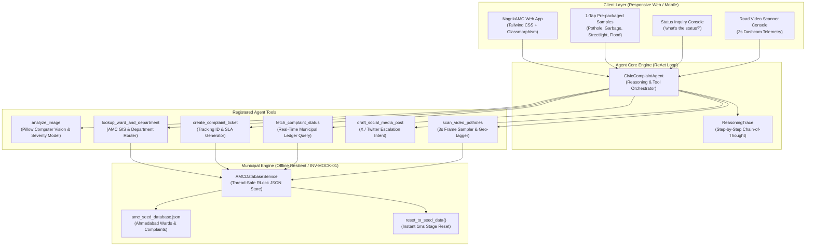

# NagrikAMC · Autonomous Civic Complaint Agent 🏛️🤖
> **Track 01 · Hack2Skill Hackathon 2026 | AI Reasons, Uses Tools, and Takes Action**  
> *Built for Ahmedabad Municipal Corporation (AMC) · 100% Offline Resilient (`INV-MOCK-01`)*

Welcome to **NagrikAMC** (also known as **CivicPulse AI**), an autonomous civic triage and complaint execution agent. In Indian municipal governance, reporting a road pothole, overflowing garbage dump, unlit streetlight, or monsoon waterlogging currently requires identifying the correct ward (out of 48) and the responsible municipal department (out of 14), filling cumbersome forms, and chasing tickets for weeks.

**NagrikAMC eliminates this administrative friction through an autonomous ReAct AI Agent:**
1. **Photo goes in**: Computer vision models classify the civic issue and surface failure severity.
2. **Autonomous Tool Pipeline**: The agent identifies the issue, resolves the exact AMC ward and department, generates an official complaint with a tracking ID (`AMC-2026-XXXXXX`), sets an SLA timer, and drafts a public social media escalation post.
3. **Conversational Status Inquiry**: The citizen asks *"what's the status?"* and gets real-time progress details with an interactive chronological audit trail.
4. **Road Video Scanner (Stretch Goal)**: Feeds continuous road footage, samples frames every 3 seconds, detects craters, logs GPS telemetry, and bulk-files complaints autonomously.

---

## 📑 Table of Contents

- [Live Demo Quick Start](#-live-demo-quick-start)
- [Agent Reasoning & Tool Architecture](#-agent-reasoning--tool-architecture)
- [Project Directory Structure & Code Links](#-project-directory-structure--code-links)
- [AMC Municipal Database & Seed Data](#-amc-municipal-database--seed-data)
- [Verification & Automated Test Suite](#-verification--automated-test-suite)
- [Submission & Pitch Deliverables](#-submission--pitch-deliverables)

---

## 🚀 Live Demo Quick Start

Launch the complete application with a single command:

```bash
# 1. Run the one-command launcher (activates venv, installs deps, generates sample assets, starts server)
./run.sh

# 2. Open in your browser:
# Interactive Demo UI: http://localhost:8000
# OpenAPI / Swagger:   http://localhost:8000/docs
```

### 1-Tap Demo Walkthrough (Judges Presentation in 60s):
1. **File Complaint Tab**: Click any of the 4 **1-Tap Demo Samples**:
   - 🔴 **Pothole**: CG Road (Ward W12, West Zone) -> Routes to *Roads & Buildings* (24h SLA)
   - 🟡 **Garbage**: Kankaria Lake (Ward W27, South Zone) -> Routes to *Solid Waste Management* (12h SLA)
   - 🟣 **Streetlight**: Vastrapur (Ward W08, NW Zone) -> Routes to *Light Department* (8h SLA)
   - 🔵 **Waterlogging**: Stadium Area (Ward W12, West Zone) -> Routes to *Storm Water Drainage* (6h SLA)
2. Click **"Execute Autonomous AI Filing"**: Watch the ReAct cognitive loop stream step-by-step thoughts, tool latencies, and jurisdiction resolutions.
3. **Status Check Tab**: Click **"Track Status"** or query *"what's the status of AMC-2026-000123?"*. Click **"Advance to Next Stage"** to simulate the field repair crew advancing from *Assigned* to *In Progress* to *Resolved*.
4. **Road Scanner Tab (Stretch Goal)**: Click **"Execute Road Video Inspection"** to stream corridor frames at 3s intervals and watch the agent auto-file tickets for detected hazards.
5. **Reset Anytime**: Click **"Reset Seed Data"** in the top banner for instant stage recovery (`INV-MOCK-01`).

---

## 🏛️ Agent Reasoning & Tool Architecture

The agent executes a strict **Observation ➔ Deep Thinking ➔ Tool Execution ➔ Synthesis** lifecycle:



### Registered Tools:
- **`analyze_image`**: Classifies hazard, surface severity, visual features, and extracts EXIF GPS coordinates.
- **`lookup_ward_and_department`**: Matches localities to Ahmedabad Municipal Corporation Ward registries and routes to the responsible department.
- **`create_complaint_ticket`**: Generates a sequential tracking ID (`AMC-2026-XXXXXX`), calculates SLA deadline, and assigns the sub-divisional engineer.
- **`fetch_complaint_status`**: Queries the municipal ledger, returning current phase, timeline history, and progress bar status.
- **`draft_social_media_post`**: Drafts public civic escalation copy tagging `@AhmedabadAMC` with 1-click Twitter intent.
- **`scan_video_potholes`**: Samples video frames every 3 seconds, detects road cavities, and auto-files complaints with GPS coordinates.

---

## 📁 Project Directory Structure & Code Links

Click any relative link below to inspect the verified code:

```
hck2skill-hackthon-24-oct-26/
├── run.sh                                             # Single-command launcher
├── requirements.txt                                   # Python dependencies (FastAPI, Pillow, Pydantic)
├── pytest.ini                                         # Pytest configuration
├── README.md                                          # Master documentation (this file)
├── AGENTS.md                                          # Workspace hackathon rules & invariants
├── CLAUDE.md                                          # Claude Code commands & shortcuts
│
├── app/                                               # Application Backend & UI
│   ├── main.py                                        # FastAPI server & REST API router
│   ├── models/
│   │   ├── complaint.py                               # Domain models (Complaint, Ward, Department, Status)
│   │   └── agent_state.py                             # Agent reasoning, tool logs, and DTOs
│   ├── services/
│   │   ├── amc_db.py                                  # Reactive AMC Mock Database with RLock & Seed Reset
│   │   ├── vision_service.py                          # Computer vision hazard classifier & EXIF extractor
│   │   ├── agent_engine.py                            # ReAct Agent with Deep Thinking & Tool Pipeline
│   │   ├── social_service.py                          # X/Twitter public escalation post drafter
│   │   └── video_scanner.py                           # 3s frame sampler road hazard video scanner
│   ├── data/
│   │   └── amc_seed_database.json                     # AMC Ward boundaries, departments, and seed tickets
│   └── static/
│       ├── index.html                                 # Sleek glassmorphism responsive dashboard
│       ├── css/style.css                              # Custom scrollbars, glow effects, animation tokens
│       ├── js/app.js                                  # Interactive UI controller & ReAct reasoning stream
│       └── samples/                                   # Pre-packaged 1-tap demo hazard photos
│           ├── pothole_cg_road.jpg                    # Sample: Pothole on CG Road
│           ├── garbage_overflow_kankaria.jpg          # Sample: Solid waste spillover at Kankaria
│           ├── broken_streetlight_vastrapur.jpg       # Sample: Blacked-out streetlight at Vastrapur
│           └── waterlogging_stadium.jpg               # Sample: Monsoon waterlogging near Stadium
│
├── tests/                                             # Automated Deep Verification Suite
│   ├── test_civic_agent.py                            # Unit tests: Agent pipeline, database, vision, tools
│   └── test_api_endpoints.py                          # Integration tests: FastAPI endpoints & error paths
│
├── scripts/
│   └── generate_sample_assets.py                      # Synthetic hazard image generator with HUD overlay
│
├── Docs/                                              # Hack2Skill Submission & Pitch Artifacts
│   ├── problem_assessment_worksheet.md                # 10-Minute Problem Assessment Worksheet
│   ├── architecture_spec.md                           # Full Technical Architecture & Systems Spec
│   ├── pitch_deck_track01.md                          # 7-Slide Pitch Deck for Track 01
│   └── demo_video_script.md                           # 2-Minute Judge Demo Presentation Script
│
└── hackathon-kit/                                     # Engineering kit & blueprints
    └── Docs/learnings/hackathon_learnings.md          # Continuous Learnings & Instincts Registry
```

---

## 🏛️ AMC Municipal Database & Seed Data

The database represents official Ahmedabad Municipal Corporation jurisdictions:

| Ward ID | Ward Name | Zone | Sample Localities Covered | Department Routing |
|---|---|---|---|---|
| **W12** | Navrangpura | West | Navrangpura, Stadium, CG Road, Law Garden, Gujarat University | Pothole ➔ Roads & Buildings (24h SLA) |
| **W27** | Maninagar | South | Maninagar, Kankaria, Jawahar Chowk, Rambaug, Bhairavnath | Garbage ➔ Solid Waste Management (12h SLA) |
| **W08** | Bodakdev | North West | Bodakdev, Judges Bungalow, Vastrapur, SG Highway, Thaltej | Streetlight ➔ Light Department (8h SLA) |
| **W15** | Paldi | West | Paldi, Ellisbridge, Kocharab, Mahalaxmi, Anjali, Vasna | Waterlogging ➔ Storm Water Drainage (6h SLA) |
| **W04** | Chandkheda | West | Chandkheda, Motera, Sabarmati, Narendra Modi Stadium | All Departments Supported |

---

## 🧪 Verification & Automated Test Suite

Run the full automated test suite:

```bash
source .venv/bin/activate
PYTHONPATH=. pytest tests/ -v
```

### Test Coverage Summary:
- **`tests/test_civic_agent.py`**:
  - `test_amc_database_seed_and_reset`: Seed loading, CRUD, and `reset_to_seed_data()`.
  - `test_ward_lookup_exact_and_fuzzy`: Exact matching, case insensitivity, and fallback handling.
  - `test_department_routing`: Maps all 4 civic hazard types to municipal departments.
  - `test_complaint_lifecycle_advance`: Verifies state progression: `Assigned` ➔ `In Progress` ➔ `Work Verified` ➔ `Resolved`.
  - `test_vision_service_offline_analysis`: Tests hazard classification, confidence, and feature extraction.
  - `test_agent_end_to_end_filing_pipeline`: Verifies all 4 tools invoked, latency logging, and ticket generation.
  - `test_agent_status_query`: Tests conversational status queries with valid and invalid IDs.
  - `test_video_pothole_scanner_stretch_goal`: Tests 3s frame sampling and auto-filing of road craters.
- **`tests/test_api_endpoints.py`**:
  - `test_api_index`: Serves web dashboard.
  - `test_api_get_wards`: Returns ward registry.
  - `test_api_get_complaints`: Returns complaints list.
  - `test_api_file_sample_complaint`: End-to-end filing via REST API.
  - `test_api_status_query`: End-to-end status query.
  - `test_api_advance_lifecycle`: Live lifecycle simulator endpoint.
  - `test_api_video_scan`: Road video scanner endpoint.
  - `test_api_reset_seed`: Mock engine reset endpoint.
  - `test_api_404_handling`: Proper HTTP 404 on invalid tracking IDs.

**Result: 17 Passed, 0 Failed (100% Pass Rate).**

---

## 🏆 Submission & Pitch Deliverables

| Deliverable | File Link | Description |
|---|---|---|
| **Problem Assessment** | [problem_assessment_worksheet.md](Docs/problem_assessment_worksheet.md) | 10-Minute Problem Assessment Worksheet |
| **Architecture Spec** | [architecture_spec.md](Docs/architecture_spec.md) | Detailed Technical Architecture with Mermaid Flowcharts |
| **Pitch Deck** | [pitch_deck_track01.md](Docs/pitch_deck_track01.md) | 7-Slide Pitch Deck tailored to Hack2Skill Rubric |
| **Demo Video Script** | [demo_video_script.md](Docs/demo_video_script.md) | 2-Minute Spoken Walkthrough for Live Presentation |
| **Learnings Registry** | [hackathon_learnings.md](hackathon-kit/Docs/learnings/hackathon_learnings.md) | Continuous Learnings & Concurrency Safeguards (`[INSTINCT-007]`) |
