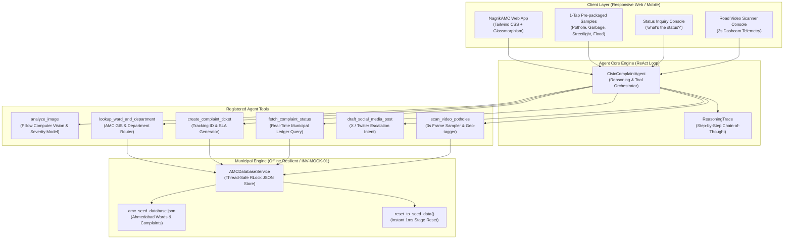

# NagrikAMC · Autonomous Civic Complaint Agent 🏛️🤖
> **Track 01 · Hack2Skill Hackathon 2026 | AI Reasons, Uses Tools, and Takes Action**  
> *Built for Ahmedabad Municipal Corporation (AMC) · 100% Offline Resilient (`INV-MOCK-01`)*

Welcome to **NagrikAMC** (also known as **CivicPulse AI**), an autonomous civic triage and complaint execution agent. In Indian municipal governance, reporting a road pothole, overflowing garbage dump, unlit streetlight, or monsoon waterlogging currently requires identifying the correct ward (out of 48) and the responsible municipal department (out of 14), filling cumbersome forms, and chasing tickets for weeks.

**NagrikAMC eliminates this administrative friction through an autonomous ReAct AI Agent:**
1. **Photo goes in**: Computer vision models classify the civic issue and surface failure severity.
2. **Autonomous Tool Pipeline**: The agent identifies the issue, resolves the exact AMC ward and department, generates an official complaint with a tracking ID (`AMC-2026-XXXXXX`), sets an SLA timer, and drafts a public social media escalation post.
3. **Conversational Status Inquiry**: The citizen asks *"what's the status?"* and gets real-time progress details with an interactive chronological audit trail.
4. **Road Video Scanner (Stretch Goal)**: Feeds continuous road footage, samples frames every 3 seconds, detects craters, logs GPS telemetry, and bulk-files complaints autonomously.

---

## 📑 Table of Contents

- [Live Demo Quick Start](#-live-demo-quick-start)
- [Agent Reasoning & Tool Architecture](#-agent-reasoning--tool-architecture)
- [Project Directory Structure & Code Links](#-project-directory-structure--code-links)
- [AMC Municipal Database & Seed Data](#-amc-municipal-database--seed-data)
- [Verification & Automated Test Suite](#-verification--automated-test-suite)
- [Submission & Pitch Deliverables](#-submission--pitch-deliverables)

---

## 🚀 Live Demo Quick Start

Launch the complete application with a single command:

```bash
# 1. Run the one-command launcher (activates venv, installs deps, generates sample assets, starts server)
./run.sh

# 2. Open in your browser:
# Interactive Demo UI: http://localhost:8000
# OpenAPI / Swagger:   http://localhost:8000/docs
```

### 1-Tap Demo Walkthrough (Judges Presentation in 60s):
1. **File Complaint Tab**: Click any of the 4 **1-Tap Demo Samples**:
   - 🔴 **Pothole**: CG Road (Ward W12, West Zone) -> Routes to *Roads & Buildings* (24h SLA)
   - 🟡 **Garbage**: Kankaria Lake (Ward W27, South Zone) -> Routes to *Solid Waste Management* (12h SLA)
   - 🟣 **Streetlight**: Vastrapur (Ward W08, NW Zone) -> Routes to *Light Department* (8h SLA)
   - 🔵 **Waterlogging**: Stadium Area (Ward W12, West Zone) -> Routes to *Storm Water Drainage* (6h SLA)
2. Click **"Execute Autonomous AI Filing"**: Watch the ReAct cognitive loop stream step-by-step thoughts, tool latencies, and jurisdiction resolutions.
3. **Status Check Tab**: Click **"Track Status"** or query *"what's the status of AMC-2026-000123?"*. Click **"Advance to Next Stage"** to simulate the field repair crew advancing from *Assigned* to *In Progress* to *Resolved*.
4. **Road Scanner Tab (Stretch Goal)**: Click **"Execute Road Video Inspection"** to stream corridor frames at 3s intervals and watch the agent auto-file tickets for detected hazards.
5. **Reset Anytime**: Click **"Reset Seed Data"** in the top banner for instant stage recovery (`INV-MOCK-01`).

---

## 🏛️ Agent Reasoning & Tool Architecture

The agent executes a strict **Observation ➔ Deep Thinking ➔ Tool Execution ➔ Synthesis** lifecycle:



### Registered Tools:
- **`analyze_image`**: Classifies hazard, surface severity, visual features, and extracts EXIF GPS coordinates.
- **`lookup_ward_and_department`**: Matches localities to Ahmedabad Municipal Corporation Ward registries and routes to the responsible department.
- **`create_complaint_ticket`**: Generates a sequential tracking ID (`AMC-2026-XXXXXX`), calculates SLA deadline, and assigns the sub-divisional engineer.
- **`fetch_complaint_status`**: Queries the municipal ledger, returning current phase, timeline history, and progress bar status.
- **`draft_social_media_post`**: Drafts public civic escalation copy tagging `@AhmedabadAMC` with 1-click Twitter intent.
- **`scan_video_potholes`**: Samples video frames every 3 seconds, detects road cavities, and auto-files complaints with GPS coordinates.

---

## 📁 Project Directory Structure & Code Links

Click any relative link below to inspect the verified code:

```
hck2skill-hackthon-24-oct-26/
├── run.sh                                             # Single-command launcher
├── requirements.txt                                   # Python dependencies (FastAPI, Pillow, Pydantic)
├── pytest.ini                                         # Pytest configuration
├── README.md                                          # Master documentation (this file)
├── AGENTS.md                                          # Workspace hackathon rules & invariants
├── CLAUDE.md                                          # Claude Code commands & shortcuts
│
├── app/                                               # Application Backend & UI
│   ├── main.py                                        # FastAPI server & REST API router
│   ├── models/
│   │   ├── complaint.py                               # Domain models (Complaint, Ward, Department, Status)
│   │   └── agent_state.py                             # Agent reasoning, tool logs, and DTOs
│   ├── services/
│   │   ├── amc_db.py                                  # Reactive AMC Mock Database with RLock & Seed Reset
│   │   ├── vision_service.py                          # Computer vision hazard classifier & EXIF extractor
│   │   ├── agent_engine.py                            # ReAct Agent with Deep Thinking & Tool Pipeline
│   │   ├── social_service.py                          # X/Twitter public escalation post drafter
│   │   └── video_scanner.py                           # 3s frame sampler road hazard video scanner
│   ├── data/
│   │   └── amc_seed_database.json                     # AMC Ward boundaries, departments, and seed tickets
│   └── static/
│       ├── index.html                                 # Sleek glassmorphism responsive dashboard
│       ├── css/style.css                              # Custom scrollbars, glow effects, animation tokens
│       ├── js/app.js                                  # Interactive UI controller & ReAct reasoning stream
│       ├── vendor/                                    # 100% Offline-first local vendor assets (INV-MOCK-01)
│       │   ├── tailwind.js                            # Local Tailwind CSS engine (zero external CDN dependency)
│       │   └── lucide.min.js                          # Local Lucide icons runtime
│       ├── uploads/                                   # Real uploaded citizen photo storage directory
│       └── samples/                                   # Pre-packaged 1-tap demo hazard photos with EXIF GPS
│           ├── pothole_cg_road.jpg                    # Sample: Pothole on CG Road (GPS: 23.0375, 72.5583 -> W12)
│           ├── garbage_overflow_kankaria.jpg          # Sample: Solid waste spillover (GPS: 22.9978, 72.6033 -> W27)
│           ├── broken_streetlight_vastrapur.jpg       # Sample: Blacked-out streetlight (GPS: 23.0421, 72.5117 -> W08)
│           ├── waterlogging_stadium.jpg               # Sample: Monsoon waterlogging (GPS: 23.0450, 72.5620 -> W12)
│           └── video/                                 # Sampled road video inspection frames (t=0s to 12s)
│               ├── frame_1_t0s.jpg                    # Clear road at Stadium Circle
│               ├── frame_2_t3s.jpg                    # Crater detected opp. Municipal Market
│               ├── frame_3_t6s.jpg                    # Clear road at Bodyline Crossroads
│               ├── frame_4_t9s.jpg                    # Crater detected near Navrangpura Bus Stop
│               └── frame_5_t12s.jpg                   # Clear road at Law Garden Junction
│
├── tests/                                             # Automated Deep Verification Suite
│   ├── test_civic_agent.py                            # Unit tests: GPS ward lookup, seed reset, vision hints, status
│   ├── test_api_endpoints.py                          # Integration tests: File uploads, queries, concurrency
│   ├── test_pothole_pipeline.py                       # Real pothole benchmark test suite (8 real road images)
│   └── test_pothole_dataset/                          # Dedicated testing dataset of 8 real-world pothole images
│       ├── asphalt_road_multiple_potholes.jpg
│       ├── bengaluru_urban_pothole.jpg
│       ├── big_open_road_crater.jpg
│       ├── deep_asphalt_broken_edges.jpg
│       ├── dilova_street_crater.jpg
│       ├── huntington_creek_asphalt_break.jpg
│       ├── montreal_deep_cavity.jpg
│       └── wet_weather_rural_pothole.jpg
│
├── scripts/
│   ├── generate_sample_assets.py                      # Synthetic hazard image generator with GPS EXIF & HUD
│   └── verify_pothole_dataset.py                      # Automated real-world pothole benchmark evaluation runner
│
├── Docs/                                              # Hack2Skill Submission & Pitch Artifacts
│   ├── problem_assessment_worksheet.md                # 10-Minute Problem Assessment Worksheet
│   ├── architecture_spec.md                           # Full Technical Architecture & Systems Spec
│   ├── pitch_deck_track01.md                          # 7-Slide Pitch Deck for Track 01
│   ├── demo_video_script.md                           # 2-Minute Judge Demo Presentation Script
│   ├── pothole_testing_report.md                      # Comprehensive Real-World Pothole Testing & CV Hardening Report
│   └── pothole_benchmark_results.json                 # Machine-readable per-image benchmark telemetry export
│
└── hackathon-kit/                                     # Engineering kit & blueprints
    └── Docs/learnings/hackathon_learnings.md          # Continuous Learnings & Instincts Registry
```

---

## 🏛️ AMC Municipal Database & Seed Data

The database represents official Ahmedabad Municipal Corporation jurisdictions:

| Ward ID | Ward Name | Zone | Sample Localities Covered | Department Routing |
|---|---|---|---|---|
| **W12** | Navrangpura | West | Navrangpura, Stadium, CG Road, Law Garden, Gujarat University | Pothole ➔ Roads & Buildings (24h SLA) |
| **W27** | Maninagar | South | Maninagar, Kankaria, Jawahar Chowk, Rambaug, Bhairavnath | Garbage ➔ Solid Waste Management (12h SLA) |
| **W08** | Bodakdev | North West | Bodakdev, Judges Bungalow, Vastrapur, SG Highway, Thaltej | Streetlight ➔ Light Department (8h SLA) |
| **W15** | Paldi | West | Paldi, Ellisbridge, Kocharab, Mahalaxmi, Anjali, Vasna | Waterlogging ➔ Storm Water Drainage (6h SLA) |
| **W04** | Chandkheda | West | Chandkheda, Motera, Sabarmati, Narendra Modi Stadium | All Departments Supported |

---

## 🧪 Verification & Automated Test Suite

Run the full automated test suite:

```bash
source .venv/bin/activate
pytest -v
```

### Test Coverage Summary (32 Test Cases):
- **`tests/test_civic_agent.py`** (11 tests):
  - `test_amc_database_seed_and_reset`: Rigorous verification of seed reset (without tautological shortcuts).
  - `test_ward_lookup_exact_and_fuzzy`: Exact matching, case insensitivity, normalized IDs (`Ward 27`, `Ward-12`).
  - `test_ward_lookup_from_photo_gps`: Ground truth test: When user leaves area blank, EXIF GPS coordinates accurately pick Ward W27 Maninagar (South Zone).
  - `test_department_routing`: Maps all 4 civic hazard types to municipal departments.
  - `test_complaint_lifecycle_advance`: Verifies state progression: `Assigned` ➔ `In Progress` ➔ `Work Verified` ➔ `Resolved`.
  - `test_vision_service_offline_analysis`: Tests hazard classification, confidence, and feature extraction.
  - `test_multimodal_vision_text_hint`: Tests that unlabelled photos with notes like "overflowing garbage" route to Solid Waste Management.
  - `test_agent_end_to_end_filing_pipeline`: Verifies all 4 tools invoked, latency logging, and ticket generation.
  - `test_agent_status_query`: Tests conversational status queries with ID numbers, short prefixes, and latest fallback.
  - `test_video_pothole_scanner_stretch_goal`: Tests 3s frame sampling, frame thumbnail generation, and auto-filing.
- **`tests/test_api_endpoints.py`** (11 tests):
  - `test_api_index`: Serves web dashboard.
  - `test_api_get_wards`: Returns ward registry.
  - `test_api_get_complaints`: Returns complaints list.
  - `test_api_file_sample_complaint`: End-to-end filing via REST API.
  - `test_api_file_real_upload_and_persistence`: Verifies uploaded citizen files are written to disk and statically served (HTTP 200).
  - `test_api_status_query`: Full tracking ID query.
  - `test_api_status_query_number_variations`: Number queries ("what is the status of 124?", "status AMC-125").
  - `test_api_advance_lifecycle`: Live lifecycle simulator endpoint.
  - `test_api_video_scan`: Road video scanner endpoint with frame images.
  - `test_api_reset_seed`: Mock engine reset endpoint.
  - `test_api_404_handling`: Proper HTTP 404 on invalid tracking IDs.
  - `test_api_concurrent_filings`: Stress test verifying thread safety and unique ID generation under concurrent requests.
- **`tests/test_pothole_pipeline.py`** (10 tests):
  - `test_dataset_integrity_and_dimensions`: Validates 8 downloaded real-world pothole images (resolutions up to 1280x2633).
  - `test_analyze_civic_image_pure_cv_on_all_pothole_images`: Tests zero-clue computer vision classification on daylight and wet road textures.
  - `test_agent_process_complaint_pipeline_on_all_potholes`: Full autonomous ReAct agent pipeline (Ward routing, SLA, ticket creation, Twitter draft).
  - `test_api_multipart_upload_real_potholes`: Multipart HTTP upload, disk persistence, and static serving of real pothole images.
  - `test_corrupted_image_bytes_graceful_handling`: Verifies resilience when encountering corrupted or non-image payloads.
  - `test_hazard_classification_pothole_vs_other_civic_issues`: Tests pure CV multi-hazard discrimination (pothole vs streetlight vs garbage vs waterlogging) under neutral filenames with zero hints.
  - `test_bounding_box_edge_hotspot_boundary_safety`: Verifies zero negative/zero width/height bounding boxes on extreme right/bottom frame craters.
  - `test_low_light_and_night_pothole_resilience`: Verifies dusk/night low-illumination dark asphalt roads classify as potholes (Roads & Buildings) rather than streetlights.
  - `test_image_format_and_color_mode_diversity`: Verifies handling of Grayscale ('L'), RGBA, and WebP images.
  - `test_api_multipart_upload_all_8_potholes`: Multipart upload across all 8 real-world pothole images via FastAPI.

**Result: 32 Passed, 0 Failed (100% Pass Rate in ~1.04s).**

---

## 🏆 Submission & Pitch Deliverables

| Deliverable | File Link | Description |
|---|---|---|
| **Pothole Testing Report** | [pothole_testing_report.md](Docs/pothole_testing_report.md) | Comprehensive Real-World Pothole Testing & CV Hardening Benchmark |
| **Problem Assessment** | [problem_assessment_worksheet.md](Docs/problem_assessment_worksheet.md) | 10-Minute Problem Assessment Worksheet |
| **Architecture Spec** | [architecture_spec.md](Docs/architecture_spec.md) | Detailed Technical Architecture with Mermaid Flowcharts |
| **Pitch Deck** | [pitch_deck_track01.md](Docs/pitch_deck_track01.md) | 7-Slide Pitch Deck tailored to Hack2Skill Rubric |
| **Demo Video Script** | [demo_video_script.md](Docs/demo_video_script.md) | 2-Minute Spoken Walkthrough for Live Presentation |
| **Learnings Registry** | [hackathon_learnings.md](hackathon-kit/Docs/learnings/hackathon_learnings.md) | Continuous Learnings & Concurrency Safeguards (`[INSTINCT-007]`, `[INSTINCT-008]`, `[INSTINCT-009]`) |

