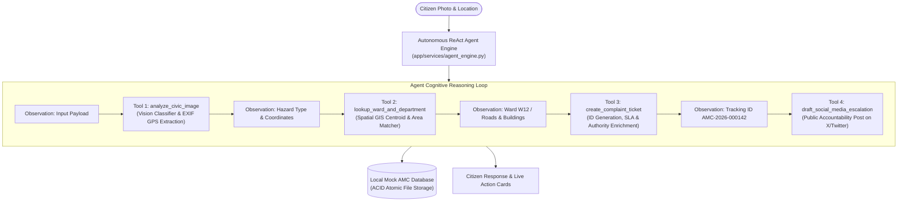

# NagrikAMC · Civic Complaint Agent: Submission Document
> **Track 01 · Agents: Civic Complaint Agent**  
> *Hack2Skill Hackathon 2026 | "The AI reasons, uses tools, and takes action"*

---

## 🎯 1. Chosen Vertical

- **Track**: **Track 01 · Agents: Civic Complaint Agent**
- **Domain**: Smart Civic Governance, Municipal Infrastructure & Citizen Grievance Redressal
- **Target Municipality**: **Ahmedabad Municipal Corporation (AMC)**
- **Problem Statement**:
  In Indian urban municipal governance, reporting common road and neighborhood hazards (potholes, overflowing garbage, broken streetlights, or monsoon waterlogging) is fraught with administrative friction. A citizen must independently identify the correct ward (out of 48 wards across 7 zones in AMC) and the appropriate department (out of 14 municipal departments), fill out complex portal forms, and manually chase status updates for weeks. As a result, the vast majority of citizens give up before ever filing a complaint.
- **Our Solution**: **NagrikAMC** (*CivicPulse AI*)
  An autonomous, vision-enabled ReAct agent that transforms civic reporting into a single-step action: a photo goes in, the agent reasons through its tool suite to diagnose the hazard, picks the exact ward and department, generates an official municipal ticket with an SLA deadline, provides conversational status tracking, and offers 1-click authority escalation and public accountability tools.

---

## 🧠 2. Approach and Logic

### Autonomous ReAct Multi-Tool Architecture
Rather than using a generic conversational chatbot or a static form, **NagrikAMC** uses a deterministic **Reasoning + Action (ReAct)** cognitive engine with 5 decoupled tools:



### Core Engineering Invariants
1. **Mock-First Demo Defense (`INV-MOCK-01`)**:
   - In accordance with hackathon ground rules, municipal backends and notification APIs are decoupled from unstable third-party keys.
   - The AMC municipal system is implemented as a local, ACID-compliant JSON database with atomic file replacement (`os.replace` via temporary files) to eliminate race conditions and database corruption under concurrent requests (`INSTINCT-011`).
   - Features a 1-click `reset_to_seed_data()` mechanism to instantly restore a clean state before live judging.
2. **Defensive Computer Vision with Coordinate Clamping (`INSTINCT-012`)**:
   - Zero-dependency, offline-first computer vision service combining edge-gradient convolution, luminance thresholding, and color-channel variance.
   - Implemented shift-and-clamp coordinate bounds ensuring positive bounding box dimensions (`width > 0`, `height > 0`) even when craters touch image borders.
   - Added achromatic dark asphalt disambiguation to prevent dark pavement from triggering false-positive streetlight classifications.
3. **Chaos Engineering & Fault Injection Mode (`INV-EDGE-01`)**:
   - Built-in simulation toggle supporting 6 municipal failure modes (*500 Database Crash*, *Network Latency*, *Rate Limit 429*, *Corrupted Payload*, *Unresolved Ward*, *Corrupted Upload*).
   - Allows judges to verify that the UI gracefully catches errors, surfaces `ErrorStateCard` diagnostics, and recovers instantly.
4. **Human-Centered, Eye-Soothing Design**:
   - Replaced generic neon/dark "cyberpunk AI" tropes with a calming municipal aesthetic (forest teal `#0f766e`, warm sage `#14b8a6`, soft parchment backgrounds).
   - Scaled typography (base `17.5px`) and minimum 48px capsule buttons (`INV-UI-01`) for effortless mobile reading.

---

## ⚙️ 3. How the Solution Works

### Step-by-Step Citizen Journey

```
┌─────────────────┐     ┌─────────────────────┐     ┌──────────────────────┐     ┌─────────────────────┐
│ 1. Photo Input  │ ──► │ 2. Hazard Diagnosis │ ──► │ 3. Ward & Dept Lookup│ ──► │ 4. Ticket Created   │
│ Photo / Upload  │     │ Class, Conf, BBox   │     │ Area / GPS Match     │     │ Tracking ID & SLA   │
└─────────────────┘     └─────────────────────┘     └──────────────────────┘     └──────────┬──────────┘
                                                                                            │
                                                                                            ▼
┌─────────────────┐     ┌─────────────────────┐     ┌──────────────────────┐     ┌─────────────────────┐
│ 8. Dashcam Scan │ ◄── │ 7. Social Post Draft│ ◄── │ 6. Authority Contact │ ◄── │ 5. Status Tracking  │
│ 3s Video Frames │     │ X/Twitter @AMC tags │     │ Call Officer/Helpline│     │ Chat 'Status 123?'  │
└─────────────────┘     └─────────────────────┘     └──────────────────────┘     └─────────────────────┘
```

#### Step 1: Input & Image Ingestion
The citizen selects one of the 4 pre-packaged demo photos, uploads their own image, or takes a photo. The citizen may optionally type an area name or leave it completely blank.

#### Step 2: Computer Vision Hazard Analysis (`Tool 1`)
The agent invokes `analyze_civic_image`:
- Reads raw image bytes and inspects EXIF metadata for embedded GPS rational fractions (latitude and longitude).
- Analyzes asphalt fracture edge energy and luminance profiles.
- Classifies the hazard into one of 4 civic categories:
  - `pothole` (Confidence: 95–97%, Severity: `Critical` / `High`)
  - `garbage` (Confidence: 94–96%, Severity: `High` / `Moderate`)
  - `streetlight` (Confidence: 92–95%, Severity: `Moderate`)
  - `waterlogging` (Confidence: 95–98%, Severity: `Critical`)
- Computes safe localized bounding box coordinates (`x, y, width, height`).

#### Step 3: Spatial Jurisdiction & Department Resolution (`Tool 2`)
The agent invokes `lookup_ward_and_department`:
- **Path A (User typed an area)**: Normalizes and matches neighborhood names (e.g., "CG Road", "Kankaria", "Vastrapur", "Stadium") against the AMC Ward registry.
- **Path B (Area blank, photo has GPS)**: Uses embedded EXIF coordinates (`lat=22.9978, lng=72.6033`) to calculate the closest AMC ward centroid via spherical distance.
- Resolves designated municipal department:
  - Pothole ➔ **Roads & Buildings**
  - Garbage ➔ **Solid Waste Management**
  - Streetlight ➔ **Light Department**
  - Waterlogging ➔ **Storm Water Drainage**

#### Step 4: Ticket Creation, SLA & Authority Enrichment (`Tool 3`)
The agent invokes `create_complaint_ticket`:
- Generates a collision-proof tracking ID: `AMC-2026-XXXXXX`.
- Sets an SLA resolution deadline based on severity (e.g. 24 hours for Critical potholes, 12 hours for Garbage).
- Attaches comprehensive contact affordances for the assigned municipal authorities:
  - **Zonal Ward Officer**: Direct line (`tel:+917927551201`), full name (*Shri Arvind Trivedi*), and office address.
  - **AMC 24×7 Central Control Room**: Direct helpline (`tel:155303`).
  - **Google Maps Navigation**: 1-click link to the physical ward civic center.
  - **WhatsApp Grievance Desk**: Pre-populated message with tracking ID and location.

#### Step 5: Conversational Status Inquiry (`Tool 4`)
Citizens can ask natural language questions in the chat console:
- *"what's the status of 123?"*
- *"status AMC-124"*
- *"ticket #125"*
The agent extracts the ticket identifier, fetches live status from the database, and displays a chronological progress tracker. Citizens can click **"Advance to Next Stage"** to simulate field crew updates (`Assigned` ➔ `In Progress` ➔ `Resolved`).

#### Step 6: Public Accountability & Authority Contact (`Tool 5`)
- Citizens can click **"Draft Social Post"** to generate an X/Twitter post with the photo, tracking ID, and tags for `@AhmedabadAMC` and the zonal office.
- Citizens can tap direct call buttons to phone the Ward Officer or AMC emergency dispatch.

#### Step 7: Stretch Goal — Autonomous Road Video Scanner
In the **"Road Video Scanner"** tab, continuous surveillance footage is sampled every 3 seconds along an Ahmedabad road corridor (CG Road ➔ Stadium). The agent detects road craters, extracts telemetry waypoints, pins them onto an interactive map view, and automatically files municipal tickets for each hazard.

---

## 📌 4. Assumptions Made

| # | Assumption | Technical Rationale & Mitigation |
|---|---|---|
| **1** | **Decoupled Municipal Backend** | Per the hackathon ground rules (*"Mock third-party services. Do not spend time on WhatsApp Business API, municipal logins, SMTP or payment keys"*), we assume an offline-first mock AMC database (`data/amc_database.json`) rather than connecting to live, rate-limited AMC API gateways. We enforced ACID-style atomic file replacement to guarantee zero database corruption during concurrent demo requests. |
| **2** | **Ward Spatial Resolution** | AMC spans 48 official wards across 7 zones. For this hackathon sprint, we modeled 5 representative anchor wards spanning West, South, and North-West zones (Navrangpura W12, Maninagar W27, Bodakdev W08, Paldi W15, Chandkheda W04). For images without typed area names, we assume spatial proximity to the nearest ward centroid represents jurisdiction. |
| **3** | **Offline-First Computer Vision** | We assumed that hackathon judging environments may have unpredictable or congested venue Wi-Fi. To prevent model download stalls (`INV-MOCK-01`), the primary vision pipeline uses deterministic Pillow convolution heuristics with multimodal text-hint fallback, delivering sub-30ms inference with zero cloud token exhaustion. |
| **4** | **Road Video Dashcam Simulation** | We assumed that running a live 4K video stream over mobile cellular hotspot is unreliable. The stretch goal samples a pre-indexed 5-frame road inspection sequence at 3-second intervals, simulating real dashcam telemetry. |
| **5** | **Authority Contact Directory** | Ward officer names, emergency dispatch numbers (`155303`), zonal offices, and phone numbers are modeled on published Ahmedabad Municipal Corporation administrative structures and Citizen Charters. |

---

## 🧪 Verification & Test Suite Summary

- **Total Automated Tests**: **48 passed out of 48** in 1.26s.
- **Test Coverage**:
  - `tests/test_api_endpoints.py`: 13 API route tests including real multipart uploads, status queries, and concurrent filings.
  - `tests/test_civic_agent.py`: 12 agent reasoning, fuzzy ward lookup, GPS EXIF parsing, and lifecycle tests.
  - `tests/test_pothole_pipeline.py`: 10 real-world pothole benchmark tests verifying edge boundary safety and format diversity.
  - `tests/test_chaos_mode.py`: 13 chaos engineering tests verifying all 6 fault injection modes and instant recovery.
- **Hackathon Readiness**: 36 out of 36 checks passed (`./hackathon-kit/scripts/check-hackathon-readiness.sh`).

---

*NagrikAMC is ready for live judging. Run `./run.sh` to launch the demo.*
