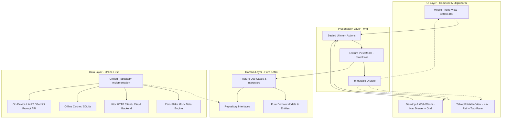

# System Architecture & Technical Specification

> **Project**: [Project Name]  
> **Platform Target**: Android, iOS, Desktop (macOS/Windows/Linux), Web (Kotlin/Wasm)  
> **Architecture Pattern**: Clean Architecture + MVI (Model-View-Intent) + Unidirectional Data Flow  

---

## 1. High-Level Architecture Diagram

---

## 2. Multi-Device Adaptive Matrix

| Form Factor | Screen Width | Navigation Component | Content Layout Strategy |
|---|---|---|---|
| **Mobile (Phones)** | `< 600dp` (Compact) | `NavigationBar` (Bottom) | Single-column scroll, thumb-friendly touch targets (`48dp`) |
| **Foldables & Tablets** | `600dp - 840dp` (Medium) | `NavigationRail` (Left) | Two-pane master-detail (`ListDetailPaneScaffold`) |
| **Desktop & Web Wasm** | `> 840dp` (Expanded) | `NavigationDrawer` (Expanded) | Responsive multi-column grid, persistent sidebar, keyboard shortcuts |

---

## 3. Data Flow & Concurrency Guarantees

1. **Unidirectional Data Flow**:
   - UI emits explicit user intents (`UiIntent`).
   - ViewModel processes intents on `Dispatchers.Default` / `Dispatchers.IO`.
   - ViewModel updates `MutableStateFlow<UiState>`.
   - UI observes state reactively using `collectAsState()`.
2. **Zero Main Thread Blocking (`INV-THREAD-01`)**:
   - All I/O, database interactions, network queries, and on-device AI inference are executed off the main thread.
3. **Mock-First Live Fallback (`INV-MOCK-01`)**:
   - The application boots with a rich in-memory mock engine populated with seed fixtures.
   - If cloud connectivity is available and configured, queries seamlessly pass through to live endpoints without altering domain contracts.
